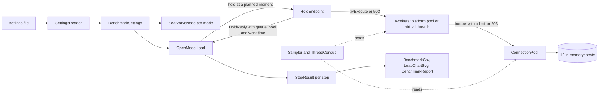

# Architecture

## The six packages

| Package | What it owns |
|---|---|
| `config` | `SettingsReader`: reads typed values from a settings file and collects every missing or invalid key. There are no defaults anywhere. |
| `node` | One SeatWave node: `NodeSettings`, `ExecutorMode`, the sealed `Workers` with `PlatformWorkers` and `VirtualWorkers`, `ConnectionPool` and `PoolSnapshot`, `SeatStore` (the seats table and its conditional `UPDATE`), `HoldRequest`, `HoldOutcome`, `HoldReply`, `HoldEndpoint` and `SeatWaveNode`. |
| `bench` | The open-model load generator `OpenModelLoad`, `BenchmarkSettings`, `StepResult`, `LatencySummary`, `Saturation`, `ThreadCensus` and `CensusLine`, the renderers `BenchmarkCsv`, `LoadChartSvg`, `BenchmarkReport`, the run `BenchmarkRun` and the `BenchmarkCli` entry point. |
| `sizing` | `LittlesLaw`, `SizingInputs`, `SizingReport` and the `SizingCli` entry point. |
| `eventloop` | Lab 3: `EventLoopServer` (one `java.nio` selector thread), `LoopMode`, `BlockingWork`, `EventLoopLab` (the clients) and the `EventLoopCli` entry point. |
| `threads` | `ThreadCost` (what many waiting threads cost), `CarrierPinning` (when a virtual thread frees its carrier and when it pins it), and their entry points `ThreadCostCli` and `PinningCli`. |

## The dependency rule

- `node` depends on `config` only.
- `bench` depends on `node` and `config`. `eventloop` uses `node.VirtualWorkers` for its bounded offload. `threads` uses `node.ExecutorMode` and `config`. `sizing` uses `config`.
- No package depends on `bench`, `sizing`, `eventloop` or `threads`.
- The `*Cli` classes are the only code that prints or exits. Everything else returns values.

## The data flow of one benchmark run

## One hold, step by step

1. `OpenModelLoad` plans the arrival moments of a step in advance: rate x duration moments, each uniformly random in the step, sorted. It parks until each moment and calls `HoldEndpoint.submit`. The calling thread plays the accept loop and never waits for a reply.
2. `submit` reads the clock and calls `Workers.tryExecute`. `PlatformWorkers` hands the task to a `ThreadPoolExecutor` with an `ArrayBlockingQueue`; when the queue is full, the abort policy throws and `tryExecute` returns false. `VirtualWorkers` takes a semaphore permit without waiting, or returns false. A false means `QUEUE_FULL`, a 503, at once.
3. On a worker, `serve` measures the queue wait. Past `queue.wait.limit.millis` it answers `QUEUE_WAIT_EXCEEDED`, a 503, without touching the database.
4. `ConnectionPool.borrow` waits on a fair `ArrayBlockingQueue` of idle connections, at most `pool.borrow.limit.millis`. Nothing in time means `POOL_TIMEOUT`, a 503. The waiting-borrower counter is raised before the wait and lowered after it.
5. With a connection, `SeatStore.hold` runs one conditional `UPDATE` with a query timeout. Then the worker keeps the connection for `database.wait.millis`, which stands for the round trip and lock waits of a database on another machine.
6. The lease closes, the connection goes back, and the reply carries the outcome and the three times. The load generator records the latency from the planned moment, so a late send counts against the node.

## Decisions and trade-offs

**Virtual threads are never pooled; a semaphore bounds them.** A pool of virtual threads would bring back the queue that virtual threads remove. The virtual-thread JEP recommends a semaphore to limit concurrency. `VirtualWorkers` uses `tryAcquire`, which never waits, so the accept loop answers a full node at once.

**Abort, never caller-runs.** `ThreadPoolExecutor.CallerRunsPolicy` would run a refused hold on the accept loop, which would then stop accepting while it waits 40 ms on the database. The node refuses instead.

**The pool is hand-written, not HikariCP.** The module asks for no new runtime library, and the pool is the thing being taught: its queue, its wait limit and its counters are 100 lines a learner can read. Production code uses HikariCP, which is on the approved list.

**The database wait is a sleep with the connection held.** Embedded H2 answers a hold in well under a millisecond, so a real remote database is modelled by keeping the connection for the configured time. The `UPDATE` still runs, so the one-owner-per-seat invariant of Module 1 is still enforced by the database and tested.

**The endpoint has no HTTP layer.** The benchmark calls the hold operation in the same process, so the network, which Module 5 measures, is outside the numbers. Every queue inside the node is still real.

**Fixed-count Poisson arrivals.** Each step sends exactly rate x duration holds at independent, uniformly random moments. That is a Poisson process with its count fixed: random bunching, as real fans have, but every step offers exactly its rate, so two steps can be compared.

**The thread census sees platform threads only.** `Thread.getAllStackTraces` does not list virtual threads; for those, `jcmd <pid> Thread.dump_to_file -format=json <file>` is the tool, and the module shows it.

## The invariant and where it is enforced

**No hold waits without bound: every queue and every pool borrow has a limit, and over the limit the hold is refused with 503, never left hanging.**

1. The executor's bound. `PlatformWorkers` uses an `ArrayBlockingQueue` with a capacity from the settings and the abort policy; `VirtualWorkers` uses a semaphore with `tryAcquire`. Tested in `WorkersTest` and in `HoldEndpointTest.refusesAtTheDoorWhenTheWorkerAndTheQueueAreTaken`.
2. The queue wait limit, checked when a worker starts the hold. Tested with a fake clock in `HoldEndpointTest.refusesAHoldThatWaitedInTheQueueLongerThanTheLimit`.
3. The borrow limit, enforced by `ArrayBlockingQueue.poll` with a timeout. Tested in `ConnectionPoolTest.givesUpAfterTheLimitWhenEveryConnectionIsLent` and `HoldEndpointTest.refusesWith503WhenNoConnectionFreesWithinTheBorrowLimit`.
4. The statement's query timeout, and the database wait from the settings.
5. Every future completes: `submit` completes the future with a refusal when the bound is reached, and the worker completes it, even on a bug. The benchmark checks the whole invariant after each step: `OpenModelLoad.awaitDrain` waits at most the longest legal hold and stops the run if any hold is still running.

The Module 1 invariant still holds and is still in the database: one conditional `UPDATE` per hold. Tested in `HoldEndpointTest.letsExactlyOneOfManyRacingHoldsWinOneSeat` (50 racing holds, one 201) and `letsAnotherFanHoldASeatOnceTheFirstHoldExpired`.

## Limits of the teaching build

- One in-memory database per node; no file is written. `NodeSettings` refuses any URL that is not `jdbc:h2:mem:`.
- The event-loop server accepts any number of connections; a production server also caps connections and closes idle ones.
- The load generator runs in the same JVM as the node, so the CPU column includes the generator.
- The command-line classes are not covered by the unit tests, because they call `System.exit`.

## How to extend it

To add a thread model, add a value to `ExecutorMode` and a class to the sealed `Workers`; the `switch` in `SeatWaveNode.start` then fails to compile until it handles the new mode. To add a measured column, add a field to `StepResult` or `Saturation`, fill it in `OpenModelLoad`, and add it to `BenchmarkCsv.HEADER` and the line format.
